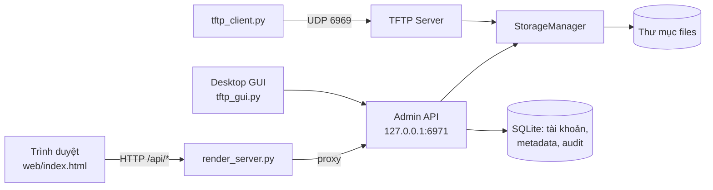

# TFTP Pro

**TFTP Server/Client bằng Python, kèm Admin API và giao diện Web quản trị tập trung.**

[](https://github.com/ThanhhBDepTrai/Group-13-LTM-TFTP/actions/workflows/ci.yml)
[](https://www.python.org/)
[](LICENSE)
[](pyproject.toml)

TFTP Pro triển khai giao thức TFTP theo RFC 1350, 2347–2349 và 7440, kèm một lớp quản trị
riêng (Admin API) để quản lý file, người dùng, phòng ban và theo dõi truyền tệp. Dự án có hai
giao diện dùng chung một backend: **Web console** chạy trên trình duyệt và **Desktop GUI** viết
bằng Tkinter.

- Không cần thư viện bên thứ ba khi chạy (chỉ `pytest`/`ruff` cho phát triển).
- Chạy được offline trong mạng lab, không phụ thuộc CDN.
- Toàn bộ truy cập file đi qua một lớp storage duy nhất, có kiểm tra đường dẫn và SHA-256.

> [!WARNING]
> TFTP không có xác thực hay mã hóa. Không mở TFTP hoặc Admin API trực tiếp ra Internet.
> Chỉ dùng trong LAN, VPN hoặc mạng lab cô lập.

---

## Mục lục

- [Tính năng](#tính-năng)
- [Kiến trúc](#kiến-trúc)
- [Cài đặt](#cài-đặt)
- [Chạy nhanh](#chạy-nhanh)
- [Cổng và biến môi trường](#cổng-và-biến-môi-trường)
- [Phân quyền](#phân-quyền)
- [Cấu trúc dự án](#cấu-trúc-dự-án)
- [Admin API](#admin-api)
- [Kiểm thử](#kiểm-thử)
- [Bảo mật và giới hạn](#bảo-mật-và-giới-hạn)
- [Tài liệu](#tài-liệu)

---

## Tính năng

### Giao thức

| Nhóm | Nội dung |
|---|---|
| RFC 1350 | RRQ, WRQ, DATA, ACK, ERROR; nhiều client, TID riêng, retry có giới hạn |
| RFC 2347–2349 | Thương lượng `blksize`, `timeout`, `tsize` qua OACK |
| RFC 7440 | `windowsize`, ACK tích lũy theo cửa sổ, tự fallback về `1` |
| An toàn dữ liệu | Ghi file nguyên tử, chặn `..`, đường dẫn tuyệt đối và symlink thoát thư mục gốc |

### Quản trị

| Nhóm | Nội dung |
|---|---|
| File Manager | Duyệt, tìm kiếm, metadata, upload, download, rename, mkdir, delete |
| Phiên bản | Tự sao lưu bản cũ trước khi ghi đè, xem lịch sử và khôi phục |
| Toàn vẹn | SHA-256 khi lưu file, đối chiếu `VERIFIED` / `MISMATCH` sau khi truyền |
| Người dùng | Tài khoản legacy và Enterprise, phân quyền theo vai trò |
| Nhân sự | Phòng ban, chức vụ, hồ sơ nhân viên, hạn mức dung lượng |
| Giám sát | Dashboard, Packet Analyzer, lịch sử giao dịch |
| Giả lập mạng | Tỉ lệ rớt gói và độ trễ áp dụng thật vào phiên TFTP |
| Vé truyền tệp | Vé 30 giây gắn IP + tên file + chế độ, có thể bật bắt buộc |
| PXE | Profile BIOS/UEFI và kiểm tra boot file (không chạy DHCP server) |

### Giao diện

- **Web console**: dashboard, File Manager, truyền file, Packet Analyzer, người dùng, nhân viên,
  PXE, phiên bản, quota, simulator. Responsive 3 mức, có dark mode, chạy offline.
- **Desktop GUI**: các tab Truyền file, File Manager, Dashboard, Packet Analyzer, Người dùng,
  Nhân viên, PXE.

## Kiến trúc



Admin API và TFTP Server là hai tiến trình/logic tách biệt nhưng dùng chung `StorageManager`,
`MetricsCollector` và `PacketTracer`. Nhờ đó số liệu hiển thị trên Web và GUI luôn khớp nhau.

## Cài đặt

Yêu cầu: **Python 3.10+**. Trên Windows, chọn thêm thành phần **Tcl/Tk** khi cài Python để dùng GUI.

```powershell
git clone https://github.com/ThanhhBDepTrai/Group-13-LTM-TFTP.git
Set-Location Group-13-LTM-TFTP
python -m venv .venv
.venv\Scripts\activate
python -m pip install -e ".[dev]"
```

Nếu PowerShell chặn `activate`, gọi trực tiếp Python trong venv:

```powershell
.\.venv\Scripts\python.exe -m pip install -e ".[dev]"
```

## Chạy nhanh

### 1. Web console (khuyến nghị)

```powershell
$env:TFTP_ADMIN_PASSWORD = "<MAT_KHAU_MANH>"
python render_server.py
```

Mở <http://127.0.0.1:10000>. `render_server.py` sẽ:

1. Khởi động backend `tftp_pro.py` với workspace `web_workspace/efm.db` và `web_workspace/files/`.
2. Chờ `/api/health` trả về `200`.
3. Phục vụ `web/index.html` và proxy mọi request `/api/*` sang Admin API.

Lần chạy đầu, tài khoản `SUPER_ADMIN` được tạo từ `TFTP_SUPER_ADMIN_PASSWORD`
(hoặc `TFTP_ADMIN_PASSWORD` nếu không đặt biến riêng).

> [!NOTE]
> `render_server.py` bật sẵn tài khoản demo (`TFTP_DEMO_ACCOUNTS=1`) và dùng mật khẩu demo mặc
> định nếu bạn không đặt `TFTP_ADMIN_PASSWORD`. Cấu hình này chỉ phù hợp khi thử trên máy local.
> Khi triển khai thật, luôn đặt `TFTP_ADMIN_PASSWORD`, `TFTP_SUPER_ADMIN_PASSWORD` và
> `TFTP_DEMO_ACCOUNTS=0`.

### 2. Desktop GUI

```powershell
python tftp_gui.py
```

Ở màn hình đầu tiên:

1. **Create Server** để tạo workspace mới, nhập thư mục lưu file.
2. Tạo tài khoản `SUPER_ADMIN` (mật khẩu tối thiểu 8 ký tự).
3. Vào tab **Người dùng** để tạo tài khoản khác; tab **Nhân viên** để tạo hồ sơ.
4. Lần sau chọn **LOGIN TO SAVED WORKSPACE**.

Workspace lưu tại `%APPDATA%\TFTPPro\servers\<workspace_id>\efm.db`; registry chỉ lưu cấu hình,
không lưu mật khẩu. Muốn chuyển máy, sao chép cả thư mục dữ liệu và thư mục file.

### 3. Chế độ legacy (TFTP + Admin API)

```powershell
$env:TFTP_ADMIN_PASSWORD = "<MAT_KHAU_MANH>"
python tftp_pro.py
```

Hoặc chạy tách riêng từng dịch vụ:

```powershell
python tftp_server.py --host 0.0.0.0 --port 6969 --root .\server_storage
python admin_api.py --root server_storage --db tftp_admin.db
```

> Không chạy `tftp_pro.py` và `tftp_gui.py` cùng lúc trên cổng mặc định `6969`/`6971`.

### 4. Client CLI

```powershell
# Tải file
python tftp_client.py --host 127.0.0.1 --port 6969 get README.md .\README.downloaded.md

# Tải lên
python tftp_client.py --host 127.0.0.1 --port 6969 put .\README.md README.md

# Tăng cửa sổ khi cả hai phía hỗ trợ RFC 7440
python tftp_client.py --host 127.0.0.1 --port 6969 --blksize 1456 --windowsize 8 get big.bin .\big.bin
```

## Cổng và biến môi trường

| Thành phần | Mặc định | Ghi chú |
|---|---|---|
| TFTP (legacy) | `0.0.0.0:6969` | `--host`, `--port` |
| TFTP (GUI/Web workspace) | `127.0.0.1:6969` | Chỉ máy đang chạy truy cập được |
| Admin API | `127.0.0.1:6971` | `--admin-host`, `--admin-port` |
| Web console | `0.0.0.0:10000` | Biến `PORT` |
| Admin DB (legacy) | `tftp_admin.db` | `--admin-db` |
| Workspace DB (web) | `web_workspace/efm.db` | Biến `EFM_WORKSPACE_DIR` |

| Biến môi trường | Ý nghĩa |
|---|---|
| `TFTP_ADMIN_PASSWORD` | Mật khẩu admin khi database chưa có tài khoản |
| `TFTP_SUPER_ADMIN_USER` / `TFTP_SUPER_ADMIN_PASSWORD` | Tài khoản SUPER_ADMIN đầu tiên của workspace |
| `TFTP_DEMO_ACCOUNTS` | `1` để tạo tài khoản demo, `0` để tắt |
| `TFTP_REQUIRE_TICKETS` | `1` để bắt buộc vé truyền cho mọi RRQ/WRQ |
| `PORT` | Cổng Web console |

Các giá trị mặc định khác nằm trong `tftp_config.py` và được CLI, GUI, benchmark dùng chung:
block size `512`, timeout `3.0s`, retries `5`, `max_clients` `20`, token TTL `8 giờ`.

## Phân quyền

Backend hỗ trợ 8 vai trò; giao diện chỉ hiển thị 4 vai trò cốt lõi để đơn giản hóa thao tác.

| Vai trò | Cấp | Phạm vi chính |
|---|---|---|
| `SUPER_ADMIN` | 100 | Toàn bộ hệ thống, không ai khác đổi được vai trò này |
| `ADMIN` | 80 | Quản trị hệ thống, chỉ gán được vai trò thấp hơn |
| `HR` | 60 | Tài khoản và hồ sơ nhân sự |
| `MANAGER` | 60 | Quản lý phòng ban và hạn mức |
| `TEAM_LEADER` | 40 | Quản lý nhóm |
| `EMPLOYEE` | 20 | Làm việc với file được cấp |
| `INTERN` | 10 | Quyền hạn chế |
| `GUEST` | 5 | Chỉ xem/tải file được Admin cấp qua Admin API |

`GUEST` không áp dụng cho TFTP thuần vì giao thức này không có xác thực.

## Cấu trúc dự án

```text
.
├── tftp_packet.py / tftp_options.py   # mã hóa, giải mã gói tin và thương lượng option
├── tftp_server.py                     # TFTP server (UDP), nhiều phiên, thread pool
├── tftp_client.py                     # TFTP client, retry, window ACK
├── storage_manager.py                 # cửa ngõ duy nhất tới filesystem
├── auth.py / database.py              # xác thực, token, SQLite legacy
├── admin_api.py                       # REST API quản trị
├── enterprise/                        # workspace, phòng ban, nhân viên, ACL, audit
├── metrics.py / packet_trace.py       # số liệu và trace gói tin
├── network_simulator.py               # giả lập rớt gói / độ trễ
├── transfer_ticket.py                 # vé truyền tệp
├── pxe_config.py                      # profile PXE
├── tftp_gui.py                        # giao diện desktop
├── web/index.html                     # giao diện web (1 file, không build step)
├── render_server.py                   # web server + proxy API
├── scripts/                           # benchmark, import workspace, đặt lại mật khẩu
└── tests/                             # pytest
```

## Admin API

Đăng nhập và lấy token (ví dụ với tài khoản Enterprise):

```bash
curl -s -X POST http://127.0.0.1:6971/api/ent/login \
  -H "Content-Type: application/json" \
  -d '{"username":"<USERNAME>","password":"<PASSWORD>"}'
```

Dùng token cho các request tiếp theo:

```bash
curl -s http://127.0.0.1:6971/api/ent/me \
  -H "Authorization: Bearer <TOKEN>"
```

Token có hiệu lực 8 giờ. Gọi `POST /api/auth/logout` để thu hồi token hiện tại.
Danh sách endpoint đầy đủ: [docs/admin_api.md](docs/admin_api.md).

Quên mật khẩu legacy:

```powershell
python scripts/set_admin_password.py --db tftp_admin.db --password "<MAT_KHAU_MOI>"
```

## Kiểm thử

```powershell
python -m pytest -q
ruff check .
```

CI chạy trên Ubuntu và Windows với Python 3.10, 3.11, 3.12: cài package, lint bằng `ruff` và
chạy toàn bộ test. Test dùng server local trên cổng ngẫu nhiên, không cần mạng hay dịch vụ ngoài.

Benchmark tốc độ:

```powershell
python scripts/benchmark_tftp.py --size 2MiB --runs 3
```

## Bảo mật và giới hạn

- Không expose TFTP/Admin API ra Internet; ưu tiên LAN, VPN hoặc mạng lab.
- Workspace tạo từ GUI chỉ bind `127.0.0.1`; mở firewall không làm máy khác kết nối được.
- Mật khẩu lưu bằng PBKDF2-HMAC-SHA256 kèm salt; token lưu dạng SHA-256, không lưu token gốc.
- Mọi đường dẫn file đi qua `StorageManager`, chặn path traversal và symlink thoát root.
- SHA-256 chỉ xác nhận nội dung, không thay thế xác thực hay mã hóa đường truyền.
- Không ghi mật khẩu, token hay khóa API vào README, commit hoặc issue. Dùng giá trị mẫu `<...>`.
- PXE chỉ quản lý profile và boot file; dự án không triển khai DHCP server.

## Tài liệu

| Tài liệu | Nội dung |
|---|---|
| [docs/architecture.md](docs/architecture.md) | Kiến trúc, luồng dữ liệu, module |
| [docs/protocol.md](docs/protocol.md) | Chi tiết gói tin, option, RFC 7440 |
| [docs/admin_api.md](docs/admin_api.md) | Endpoint, quyền, ví dụ gọi API |
| [docs/database.md](docs/database.md) | Lược đồ cơ sở dữ liệu |
| [docs/interface.md](docs/interface.md) | Interface module và CLI |
| [docs/multi_server.md](docs/multi_server.md) | Workspace Enterprise và kết nối server |
| [docs/pxe_lab.md](docs/pxe_lab.md) | Dựng lab PXE |
| [docs/benchmark.md](docs/benchmark.md) | Cách đo và đọc kết quả |
| [CHANGELOG.md](CHANGELOG.md) | Lịch sử thay đổi |
| [CONTRIBUTING.md](CONTRIBUTING.md) | Quy ước đóng góp |

## Đóng góp

1. Tạo nhánh riêng cho từng thay đổi.
2. Chạy `ruff check .` và `python -m pytest -q` trước khi mở pull request.
3. Mô tả rõ thay đổi và cách kiểm tra trong PR.

## Giấy phép

Phát hành theo giấy phép [MIT](LICENSE).

---

<details>
<summary><strong>English summary</strong></summary>

TFTP Pro is a Python TFTP client/server with an authenticated Admin API, a single-file web
console and an optional Tkinter desktop GUI. It implements RFC 1350, RFC 2347–2349 and RFC 7440,
adds SHA-256 integrity checks, file versioning, department quotas, network fault simulation,
transfer tickets and PXE boot profiles.

```bash
pip install -e ".[dev]"
export TFTP_ADMIN_PASSWORD='change-me'   # PowerShell: $env:TFTP_ADMIN_PASSWORD='change-me'
python render_server.py                  # web console at http://127.0.0.1:10000
python tftp_gui.py                       # desktop GUI
python tftp_client.py get README.md ./README.downloaded.md
```

The Admin API binds to localhost by default. Never expose TFTP or the Admin API to the Internet.
No DHCP server is included; PXE support covers boot profiles and files for isolated labs.

</details>
